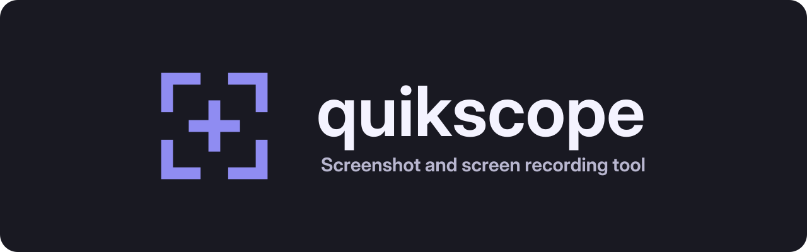
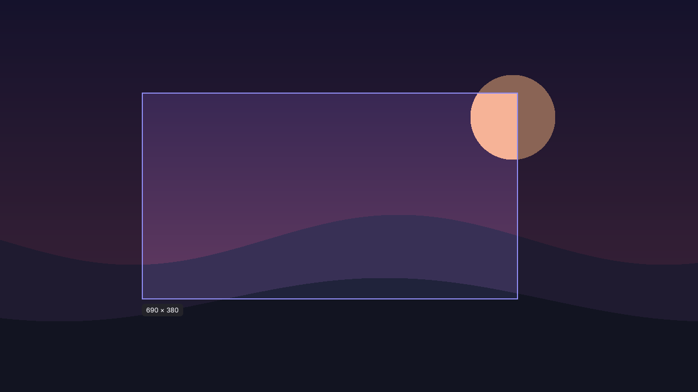
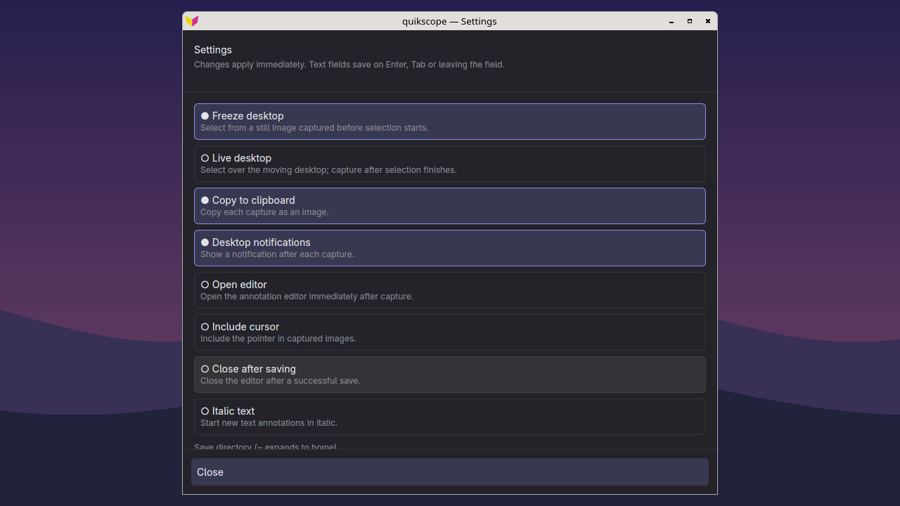
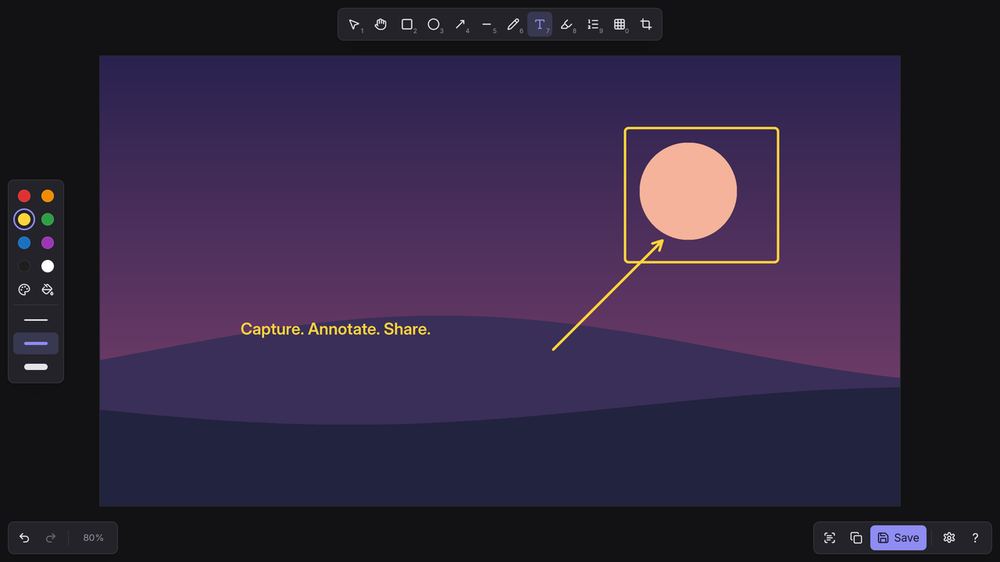

# quikscope

A fast screenshot and screen recording tool for Linux (wlroots compositors
such as Hyprland and sway, X11, and experimental GNOME/KDE portal support)
and Windows, with built-in annotation and video editors written in
[GPUI](https://gpui.rs).



```text
keybind ─▶ quikscope capture region ─▶ frozen-screen selection ─▶ clipboard + notification
                                                                     │ click / --edit
                                                                     ▼
                                      editor (arrows, boxes, text, pen, pixelate, crop…)
                                                                     │ Ctrl+S
                                                                     ▼
                                                 ~/Pictures/Screenshots/screenshot_*.png
```

- **Fast.** A resident daemon keeps the display connection, capture buffers
  and GPU device warm. A 2560×1440 capture completes in ~15 ms; clipboard PNG
  encoding finishes ~22 ms later. The editor paints its first frame ~5 ms after creation
  (see [Performance](#performance)).
- **Desktop-specific backends.** `wlr-screencopy` on wlroots compositors, the
  experimental Screenshot portal on GNOME/KDE, MIT-SHM on X11 and DXGI on
  Windows; the backend is picked at start-up ([details](#desktops)).
- **Frozen or live region selection** (frozen by default), spanning outputs where
  the backend permits, with window snapping on Hyprland, X11 and Windows
  (Windows snapping is not yet verified natively). Live selection dims outside the rectangle and
  leaves a transparent hole; pixels are captured after selection closes.
- **Excalidraw-style editor**: rectangle, ellipse, arrow, line, pen,
  highlighter, text, numbered steps, pixelate (redaction) and crop, with
  undo/redo, zoom and pan. What you see is exactly what gets saved — the
  editor and the PNG exporter fill the same geometry.
- **Text extraction**: copy the text out of a region or a screenshot, in
  English and other European languages, Chinese, Japanese, Korean,
  Vietnamese, Thai and Arabic, each line read in its own language
  ([details](docs/text-extraction.md)).
- **Recording**: videos (H.264 in MP4/MKV/MOV, encoded on the GPU where the
  driver supports it, with desktop and microphone audio) and animations
  (GIF/WebP/AVIF/JPEG XL) of a region, output or window. The same key starts
  and stops; the file lands on the clipboard ([details](#recording)).
- **Opens your files**: images and animations in the annotator, videos in a
  small trim/convert editor, from the command line or your file manager.
- **Plain IPC**: one text line over a local socket; usable from keybinds,
  scripts or `socat`.

## Install

Download packages from [GitHub Releases](https://github.com/qt715/quikscope/releases).
Packages include the complete third-party licence report and bundled asset licences.

### Linux packages

Linux x86_64 builds target Ubuntu 24.04's glibc baseline (2.39); use a source
build on older distributions. Install a `.deb` with `sudo apt install ./quikscope_*_amd64.deb`
or an `.rpm` with `sudo dnf install ./quikscope-*.x86_64.rpm`.
On openSUSE use `sudo zypper install ./quikscope-*.x86_64.rpm`.
The packages install the desktop launcher, hicolor icons and a systemd user unit:

```sh
systemctl --user enable --now quikscope.service # optional login startup
```

Arch users can download the release `PKGBUILD` (and `SRCINFO`, which is the
recipe's `.SRCINFO`), inspect them, then run `makepkg -si`. This recipe is
AUR-ready, not a claim of an AUR listing.
See [Desktops](#desktops) for compositor requirements. OCR and a portal backend
are optional; a working Vulkan driver is needed for the editor.

### Windows installer

Run `quikscope-<version>-windows-x86_64-installer.exe`. It installs for the current
user under `%LOCALAPPDATA%\Programs\quikscope`, without administrator access,
and offers optional **Start at login**. Start quikscope from the Start menu.
Re-running the installer upgrades in place; remove it through Installed Apps.
User settings and saved screenshots are retained on uninstall; app cache files are removed.

The installer is unsigned. SmartScreen may warn; only proceed with **More info →
Run anyway** after checking the download source and published SHA-256 checksum.
See [Windows 10/11](#windows-1011) for usage and optional OCR setup.

### Cargo

Install from crates.io with Rust ≥ 1.95 and the platform development
dependencies described below:

```sh
cargo install --locked quikscope
```

From a source checkout, use `cargo install --locked --path .` instead.

quikscope needs no FFmpeg: its codecs (OpenH264, libopus, libwebp, zstd) are
compiled from source into the executable. Building needs a C and C++
compiler and CMake 3.16 or newer; NASM, when installed, makes the OpenH264
software encoder faster. On Linux it also needs clang (for the PipeWire
bindings), pkg-config and the development files of Wayland, xkbcommon,
PulseAudio, PipeWire, ALSA, libgbm, fontconfig and FreeType:

```sh
# Arch
sudo pacman -S --needed base-devel clang cmake nasm pkgconf wayland libxkbcommon \
  libxkbcommon-x11 libpulse libpipewire alsa-lib mesa fontconfig freetype2
# Debian/Ubuntu
sudo apt install build-essential clang cmake nasm pkg-config libwayland-dev libxkbcommon-dev \
  libxkbcommon-x11-dev libx11-xcb-dev libfontconfig-dev libfreetype-dev libasound2-dev \
  libgbm-dev libpipewire-0.3-dev libpulse-dev
```

On Windows the Visual Studio C++ Build Tools with their CMake component are
enough (NASM on `PATH` is optional).

The packaged service uses `/usr/bin/quikscope`. For a Cargo installation, copy
it to `~/.config/systemd/user/quikscope.service` and change `ExecStart` to the
absolute path of your Cargo-installed executable before enabling it.

The daemon is optional at login: any `quikscope` command starts it on demand
(the first capture then pays the daemon start-up, about 0.3 s, once).

On first start, a short welcome window lets you choose frozen or live region
selection and common capture defaults. Done or closing the welcome window
writes your configuration; subsequent starts stay in the background.
Run `quikscope settings` any time (also the editor's gear button or Windows
tray **Settings…**). Changes save and apply to the running daemon immediately.



Text extraction additionally needs Tesseract and a model per language,
loaded at run time (nothing extra to build):

```sh
# Arch
sudo pacman -S tesseract tesseract-data-eng tesseract-data-jpn tesseract-data-chi_sim \
  tesseract-data-kor tesseract-data-vie tesseract-data-tha tesseract-data-ara
# Debian/Ubuntu
sudo apt install tesseract-ocr tesseract-ocr-eng tesseract-ocr-jpn tesseract-ocr-chi-sim \
  tesseract-ocr-kor tesseract-ocr-vie tesseract-ocr-tha tesseract-ocr-ara
```

## Desktops

The daemon picks a backend at start-up and logs it (`platform backend: …`);
`QUIKSCOPE_BACKEND=wlroots|portal|x11` on the daemon forces one.

| Desktop | Capture | Region overlay | Window snapping, `window` mode |
| --- | --- | --- | --- |
| Hyprland, sway, river, labwc, … | `wlr-screencopy` | layer-shell, all outputs | Hyprland only |
| KDE Plasma (experimental) | Screenshot portal | layer-shell, all outputs | no |
| GNOME (experimental) | Screenshot portal | one fullscreen window, one output | no |
| X11 | MIT-SHM (GetImage remotely) | override-redirect popups | EWMH window managers |
| Windows 10/11 | DXGI duplication (GDI fallback) | topmost popups | implemented, unverified |

### wlroots compositors

Needs `wlr-screencopy`, `wlr-layer-shell` and `wlr-data-control`. Check your
compositor's protocol support; automated coverage uses headless labwc and
sway. Bind keys as shown for [Hyprland](#hyprland); on sway:

```ini
bindsym Print exec quikscope capture region
bindsym Shift+Print exec quikscope capture screen
bindsym $mod+Shift+e exec quikscope open-last
bindsym $mod+Shift+c exec quikscope pick
for_window [app_id="quikscope"] floating enable
```

### Hyprland

`hyprland.lua`:

```lua
hl.bind(mainMod .. " + SHIFT + S", hl.dsp.exec_cmd("quikscope capture region"), { description = "Screenshot region" })
hl.bind(mainMod .. " + SHIFT + CTRL + S", hl.dsp.exec_cmd("quikscope capture output"), { description = "Screenshot monitor" })
hl.bind(mainMod .. " + SHIFT + ALT + S", hl.dsp.exec_cmd("quikscope capture region --edit"), { description = "Annotate region" })
hl.bind(mainMod .. " + SHIFT + E", hl.dsp.exec_cmd("quikscope open-last"), { description = "Edit last screenshot" })
hl.bind(mainMod .. " + SHIFT + X", hl.dsp.exec_cmd("quikscope capture region --text"), { description = "Copy text from region" })
hl.bind(mainMod .. " + SHIFT + C", hl.dsp.exec_cmd("quikscope pick"), { description = "Pick a color" })
hl.bind(mainMod .. " + SHIFT + R", hl.dsp.exec_cmd("quikscope record video"), { description = "Record video (again: stop)" })
hl.bind(mainMod .. " + SHIFT + G", hl.dsp.exec_cmd("quikscope record animation"), { description = "Record GIF (again: stop)" })

hl.window_rule({ match = { class = "^(quikscope)$" }, float = true, center = true })
hl.layer_rule({ match = { namespace = "^(quikscope-selection|quikscope-outline)$" }, no_anim = true })
```

`hyprland.conf`:

```ini
bind = $mainMod SHIFT, S, exec, quikscope capture region
bind = $mainMod SHIFT CTRL, S, exec, quikscope capture output
bind = $mainMod SHIFT ALT, S, exec, quikscope capture region --edit
bind = $mainMod SHIFT, E, exec, quikscope open-last
bind = $mainMod SHIFT, X, exec, quikscope capture region --text
bind = $mainMod SHIFT, C, exec, quikscope pick
bind = $mainMod SHIFT, R, exec, quikscope record video
bind = $mainMod SHIFT, G, exec, quikscope record animation
windowrule = float on, match:class ^(quikscope)$
windowrule = center on, match:class ^(quikscope)$
layerrule = no_anim on, match:namespace ^(quikscope-selection|quikscope-outline)$
```

`no_anim` on the selection layer makes the frozen overlay appear instantly
instead of fading in; on the outline layer it keeps the recording frame from
fading in after recording has started.

### GNOME / KDE Plasma (portal)

**Experimental:** portal integration has been tested only against a simulated
Screenshot portal in private headless labwc sessions, not real GNOME or KDE.
Permission dialogs, placement and clipboard bridging need real-desktop validation.

Needs a session D-Bus, `xdg-desktop-portal` and the desktop's backend
(`xdg-desktop-portal-gnome` or `xdg-desktop-portal-kde`), which those
desktops install by default. Bind keys in Settings → Keyboard → Custom
Shortcuts (GNOME) or System Settings → Shortcuts → Add New → Command (KDE)
with commands such as `quikscope capture region`. On GNOME from a terminal:

```sh
p=/org/gnome/settings-daemon/plugins/media-keys/custom-keybindings/quikscope/
gsettings set org.gnome.settings-daemon.plugins.media-keys custom-keybindings "['$p']"
gsettings set org.gnome.settings-daemon.plugins.media-keys.custom-keybinding:$p name 'Screenshot region'
gsettings set org.gnome.settings-daemon.plugins.media-keys.custom-keybinding:$p command 'quikscope capture region'
gsettings set org.gnome.settings-daemon.plugins.media-keys.custom-keybinding:$p binding '<Shift><Super>s'
```

(The first command replaces existing custom shortcuts; merge the list by hand
if you have some.)

The daemon falls back to `org.freedesktop.portal.Screenshot` when
`wlr-screencopy` is unavailable. Set `QUIKSCOPE_BACKEND=portal` on the
daemon to force it (or `QUIKSCOPE_BACKEND=wlroots` to require native capture).
The desktop can still ask permission despite `interactive=false`; accept
its permission dialog to capture. Cancelling or denying returns a clear error.
With live region selection (`--no-freeze`), the permission dialog appears
only after selection closes; denying it still fails the capture.

Portal capture decodes a PNG file and is slower than native screencopy.
The portal controls cursor inclusion: `--cursor` / `--no-cursor` cannot
override it. On KDE and other desktops offering layer-shell, region
selection spans all outputs. Without layer-shell (normally GNOME), a
single fullscreen normal window shows the output where the compositor
places it; selection is confined to that output. Frozen mode shows its
snapshot; live mode is transparent only when the compositor permits
transparent fullscreen windows.
`screen` and fixed geometry captures can still span outputs. Desktop
fullscreen/focus animations can delay appearance; disable them in desktop
settings if needed. There is no window list/snapping or active-window
capture; `output` defaults to the first output. The portal raster must
cover the logical desktop at a uniform scale; incompatible mixed-scale
rasters are rejected rather than cropped incorrectly.

Clipboard uses data-control where available (including supported KDE
versions), otherwise Xwayland CLIPBOARD when DISPLAY is set. GNOME normally
bridges that selection to native Wayland apps. Without either backend, use
`--no-clipboard --save` (or edit/save). Notifications still work.
For diagnostics, `QUIKSCOPE_DEBUG_NO_LAYER_SHELL=1` on the daemon forces
the single-output fullscreen path, even on a layer-shell compositor.
Portal PNGs are not deleted: the API does not transfer ownership, and
GNOME/KDE may save into Pictures rather than create disposable files.

### X11

On X11, `DISPLAY` selects the backend when `WAYLAND_DISPLAY` is unset.
`QUIKSCOPE_BACKEND=x11` explicitly selects it (including on Xwayland).
MIT-SHM accelerates local captures; remote servers fall back to GetImage.
RandR 1.5 monitor names identify outputs; older servers expose one `screen-N`
output. X11 coordinates are physical pixels (scale 1). An EWMH window manager
enables active-window capture, window snapping and focused-output detection;
without one those queries are unknown. No X11 command-line helpers are needed
at runtime. Clipboard PNGs are served without re-encoding, including large
images via the X11 INCR protocol.
Live selection requires a compositor, an alpha visual and the X Present
extension; otherwise quikscope logs the limitation and uses frozen selection.

Bind keys in your window manager or desktop settings, e.g. i3:

```ini
bindsym Print exec --no-startup-id quikscope capture region
bindsym Shift+Print exec --no-startup-id quikscope capture screen
```

### Windows 10/11

Build on Windows 10 (1803+) or Windows 11 with Rust ≥ 1.95 and the Visual Studio C++ Build Tools (with CMake).
Native verification used Windows 11 on one monitor at 96 DPI. Windows 10,
multiple monitors, mixed DPI, window snapping and active-window capture are
implemented but unverified. Frozen and live region selection were both verified.

```powershell
cargo install --locked quikscope
quikscope autostart on
quikscope capture screen --save
```

`autostart on|off|status` manages only the current user's `quikscope` value
under `HKCU\Software\Microsoft\Windows\CurrentVersion\Run`. The daemon has no
console window; commands attach to the invoking terminal. `quikscope.exe` is
a GUI program, so PowerShell and `cmd` do not wait for a command run on its
own; a script that needs its output or exit code captures the output
(`quikscope version | Out-String`, `quikscope record status > status.txt`)
or uses `Start-Process -Wait`. The daemon's log is
`%LOCALAPPDATA%\quikscope\daemon.log`.

The notification-area icon offers region, screen and window capture, the
latest screenshot, recording controls, notifications on/off and quit. Default
global shortcuts: `PrintScreen` = region, `Ctrl+PrintScreen` = screen,
`Alt+PrintScreen` = foreground window, `Shift+PrintScreen` = open last,
`Ctrl+Shift+PrintScreen` / `Ctrl+Alt+PrintScreen` = start or stop a video /
animation recording. Enable or disable them in Settings, or configure them in
[`[hotkeys]`](docs/configuration.md); Windows or another application can
reserve a shortcut, in which case startup logs the registration error.

If Windows opens Snipping Tool instead, turn off **Settings → Accessibility →
Keyboard → Use the Print screen key to open screen capture**, then restart
quikscope (Windows may also require refreshing Explorer or signing in again).
Windows 11 enables this setting by default. quikscope logs a startup warning
and shows one notification when it is enabled; Settings also shows the remedy
beside the Windows hotkeys. quikscope does not change that Windows setting.

Configuration is `%APPDATA%\quikscope\config.toml`, cache/log/IPC live in
`%LOCALAPPDATA%\quikscope`, and saves use the Windows Pictures known folder
plus `Screenshots` (including redirected Pictures folders). Clipboard images
offer registered `PNG`, `CF_DIBV5` and `CF_DIB`; text uses `CF_UNICODETEXT`.
Capture notifications use Windows shell balloons; their display duration and
visibility follow Windows notification settings.

Capture retains DXGI duplication resources and falls back to reusable GDI
buffers when duplication is unavailable (including some virtual displays).
`QUIKSCOPE_WINDOWS_CAPTURE=gdi` forces GDI for comparison. Coordinates passed
to `--geometry` on Windows are **physical desktop pixels**, including negative
monitor origins. The per-monitor-v2-aware overlay converts surface DIPs at its
boundary; mixed-DPI and multi-monitor behavior still needs native verification.
Protected/secure desktops and protected video cannot be captured.
Text extraction optionally needs Tesseract's `libtesseract-5.dll` (or
`tesseract55.dll` / `libtesseract.dll`) beside the executable, in
`%ProgramFiles%\Tesseract-OCR`, or in an absolute directory on `PATH`.
Models are found via `TESSDATA_PREFIX`, `%ProgramFiles%\Tesseract-OCR\tessdata`
or `tessdata` beside the executable. Windows OCR is not yet verified natively.

## Usage

```text
quikscope capture <region|output|window|screen> [options]
quikscope record <video|animation> [region|output|window] [options]   run again to stop
quikscope record <stop|pause|resume|toggle-pause|cancel|status>
quikscope audio-devices      list devices recordings can include
quikscope open-last          open the latest capture in the editor, with the tool you used last
quikscope pick               pick a color anywhere on screen; prints its hex
quikscope open [FILE]...     open images, animations and videos (no file: the latest capture)
quikscope settings          open or focus capture/editor/recording preferences
quikscope notifications <on|off|toggle|status>
quikscope daemon             run the daemon in the foreground
quikscope version            print the client's and the daemon's versions
quikscope ping | quit
```

| Mode | Captures |
| --- | --- |
| `region` | Freezes the screen by default (`--no-freeze` selects over the live desktop); drag a rectangle, click a window (Hyprland, X11/EWMH; Windows implemented but unverified) or click empty space for the whole output. GNOME portal selection is confined to one output. Right click, `Esc` or `q` cancels; `Enter` takes the output under the keyboard focus. |
| `output` | The focused output on Hyprland or X11/EWMH, the first output elsewhere, or `-o NAME`. |
| `window` | The active window (Hyprland, X11/EWMH or Windows; Windows unverified). |
| `screen` | All outputs composed in their layout. |

| Option | Effect |
| --- | --- |
| `--edit` / `--no-edit` | Open the editor immediately instead of on notification click. |
| `--notify` / `--no-notify` | Desktop notification with a thumbnail; clicking it opens the editor. |
| `--clipboard` / `--no-clipboard` | Put the capture on the clipboard as `image/png`. |
| `--cursor` / `--no-cursor` | Include the pointer. |
| `--freeze` / `--no-freeze` | Freeze before region selection (default) / select over the live desktop and capture after the overlay closes. Overrides `freeze` in the config. |
| `--save` | Also write the raw capture to the screenshots folder (prints the path). |
| `--text` | Extract the capture's text: copy it as plain text (instead of the image), print it, and show it in the notification. Exit status 1 when no text was found. |
| `-o, --output NAME` | Output for `output` mode. |
| `-g, --geometry "X,Y WxH"` | Capture a logical rectangle without interaction (`slurp` format). |

Exit status is 0 on success, 1 when the selection was cancelled or an error
occurred. Defaults come from the [configuration](docs/configuration.md).

### Picking colors

`quikscope pick` freezes the screen (without the pointer) and shows a
magnifier of the pixels at the pointer with the hex value of the middle one.
Click, or press `Enter`, to pick that pixel; on a scaled output it is the
physical pixel under the pointer. Right click, `Esc` or `q` cancels.
The command prints the color (`#0067ed`) and opens a small window that copies
it as HEX, RGB, CMYK, HSV or HSL with one click (`Ctrl+C` copies HEX, **Pick
again** picks another). The Windows tray menu has **Pick color**. In the
editor, `I` or the color picker's eyedropper picks into the drawing color
instead.

### Notifications on/off

`notify = false` in the config file turns capture notifications off.
`quikscope notifications toggle` (or `on`/`off`) flips the setting in the
running daemon at once and writes it back to the config file, keeping your
other settings and comments, so it survives restarts; `status` prints it.
Bind it to a key to switch notifications off while gaming or presenting:

```lua
hl.bind(mainMod .. " + SHIFT + N", hl.dsp.exec_cmd("quikscope notifications toggle"), { description = "Toggle screenshot notifications" })
```

`--notify` / `--no-notify` still override the setting for a single capture.

## Recording

```text
Super+Shift+R ─▶ quikscope record video ─▶ select over the live desktop ─▶ recording (outline + tray timer)
Super+Shift+R ─▶ quikscope record video ─▶ ~/Videos/Screencasts/recording_*.mp4 ─▶ clipboard + notification
```

`quikscope record video` and `quikscope record animation` start a recording;
running either again (or `quikscope record stop`, or the tray's **Stop and
save**) stops it, saves the file, puts it on the clipboard **as a file** (paste
it into Discord, a browser upload or a file manager) and shows a notification
with a thumbnail; clicking it opens the video editor or, for animations, the
annotator. Nothing counts down: recording starts when the selection is made.

| | Video | Animation |
| --- | --- | --- |
| Formats | MP4 (default), MKV, MOV — H.264 | GIF (default), WebP, AVIF, JPEG XL |
| Frame rate | 60 fps (1–240) | 30 fps (1–60) |
| Audio | Opus; desktop audio by default; any inputs and outputs, mixed | none |

The region is selected over the live desktop like `capture region
--no-freeze` (`Enter` or a click on empty space takes the whole output;
Hyprland/X11 window snapping applies). `output` records the focused output,
`window` the active window's current rectangle. A recording covers one
output; a selection spanning several is clipped to the one holding most of it.
While recording, a thin outline (the accent color) sits just outside the area.
It is never in the recording and lets clicks through. Whole-output recordings
have none.

| Option | Effect |
| --- | --- |
| `--fps N` | Frames per second for this recording. |
| `--format F` | `mp4`, `mkv`, `mov`; `gif`, `webp`, `avif`, `jxl`. |
| `--audio ID` | Record this device (repeat for several); `--no-audio` records none. Ids come from `quikscope audio-devices`; `default-output` is what you hear, `default-input` the default microphone. |
| `--cursor`, `--edit`, `--notify`, `--clipboard` (and `--no-…`), `-o`, `-g` | As for `capture`. |

`record pause` / `resume` / `toggle-pause` leave the paused time out of the
file; `record cancel` discards it; `record status` prints the kind, elapsed
time and state, or `saving 42%` while a stopped recording is still being
written (a long GIF or AVIF takes a while). Defaults (folder, formats, frame
rates, audio, outline, encoder) live in `[record]` in the
[configuration](docs/configuration.md) and the Settings window.

Quitting (`quikscope quit`, the tray's Quit, stopping the service, logging
out) saves a running recording and waits for saves and exports still
running. A capture larger than any H.264 encoder on the machine takes (very
wide areas) is recorded scaled down, with a notification saying so.

**Tray.** On Linux a status-notifier tray icon (Waybar, Noctalia, KDE,
GNOME with the AppIndicator extension…) offers Record video/animation, the
audio devices and frame rates; while recording it shows the elapsed time with
Pause/Resume, Stop and save and Discard, and a click on the icon stops. While
a stopped recording is saved it shows the percentage and **Cancel saving**,
which discards a video and keeps an animation's lossless recording to export
from the annotator. `record.tray = false` hides it. The Windows tray menu has
the same items.

**Encoding.** quikscope has no FFmpeg dependency: it writes MP4, MOV and MKV
itself and carries its own encoders. Videos are H.264, encoded on the GPU
through Vulkan Video (NVIDIA, AMD and Intel with recent drivers) and
otherwise by the built-in OpenH264 software encoder; `record.encoder =
"software"` skips the GPU (for decoding too). Sound is Opus in every
container. MP4 recordings are fragmented by default and written under their
final name, so a crash or kill leaves a file that plays up to its last
fragment (about a second); `record.mp4_fragmented = false` instead writes a
classic MP4 with its index at the front when the recording ends. MOV is
always written the classic way, MKV in one cluster per keyframe, in place
like fragmented MP4. A classic MP4 or MOV cut short by a crash, and an
animation that was never encoded, are recovered the next time the daemon
starts (see [crash recovery](docs/configuration.md#crash-recovery)). A new
file never replaces an existing one: a taken name gets `-1`, `-2`, ….
Animations are recorded losslessly to the cache first and encoded when you
stop, so annotating them later loses nothing. Every frame keeps its exact
display time through recording, annotating and re-encoding, including
variable-delay GIFs; GIF frames each get their own dithered palette.

**Capture.** On wlroots compositors frames are copied by the compositor into
GPU buffers (DMA-BUF) whenever it offers them, and converted on quikscope's
side. A compositor that offers no DMA-BUF gets shared-memory capture instead,
with a warning in the log: Hyprland reads shared-memory captures back
synchronously on its main thread, which can make games stutter. X11 uses
MIT-SHM, Windows Desktop Duplication, and GNOME/KDE the ScreenCast portal
(experimental; the first recording asks for permission, later ones reuse the
stored grant).

## Opening files

`quikscope open FILE...` opens PNG, JPEG, WebP, AVIF, JPEG XL and GIF images
in the annotator. Animated GIF, WebP, AVIF, JPEG XL and APNG files open in the
annotator's animation mode. H.264 videos in MP4, MOV or MKV, with AAC,
Opus or no sound, open in the video editor; HEVC, VP9 and AV1 videos are not
supported. Without a file it opens the latest capture.

The packages' desktop entry declares these types, so file managers list
quikscope under **Open with** (`xdg-mime default quikscope.desktop video/mp4`
makes it the default). The Windows installer adds it to Explorer's **Open
with** menu.

## Editor



Tools sit in the bar at the top. While a drawing tool is active or shapes are
selected, the side panel on the left holds the colors, the color picker, fill
and stroke size. Undo, redo and the zoom level (click to fit) are bottom left;
copy text, copy, **Save**, settings and shortcut help bottom right.

| Tool | Keys |
| --- | --- |
| Select / move | `V` `1` — drag empty canvas to select fully-contained items; `Shift`+click toggles membership, `Ctrl+A` selects all. Drag any selected item to move the whole selection (including from inside its box); `Del` deletes, arrows nudge (`Shift` ×10), double-click text to edit. Each gesture is one undo step |
| Pan | `H`, `Space`+drag, middle drag, scroll |
| Rectangle | `R` `2` (`Shift` = square) |
| Ellipse | `O` `3` (`Shift` = circle) |
| Arrow | `A` `4` (`Shift` snaps to 15°) |
| Line | `L` `5` (`Shift` snaps to 15°) |
| Pen | `P` `6` |
| Text | `T` `7` — click, type, `Enter` for a new line, `Esc` or click away to finish |
| Highlighter | `M` `8` |
| Step number | `N` `9` — numbered badges that count up |
| Pixelate | `X` `0` — irreversible mosaic for redaction |
| Crop | `C` — drag the area to keep; click without dragging to reset |

| Action | Keys |
| --- | --- |
| Save to `~/Pictures/Screenshots` | `Ctrl+S` (repeat saves update the same file); `Ctrl+Shift+S` always writes a new file |
| Copy annotated image | `Ctrl+C` |
| Copy text (from the crop, else the whole screenshot; annotations are not read) | `Ctrl+Shift+C` or the scan button; the lines read light up briefly |
| Undo / redo | `Ctrl+Z` / `Ctrl+Shift+Z`, `Ctrl+Y` |
| Fill shapes | `F` |
| Stroke / text size | `[` `]` or the stroke samples in the side panel |
| Pick a color anywhere on screen (eyedropper) | `I` or **Pick from screen** in the color picker |
| Duplicate selection | `Ctrl+D` — new copies offset by 10 logical pixels, selected together; `Ctrl+C` still copies the image |
| Bring selection to front / send to back | `Ctrl+Shift+]` / `Ctrl+Shift+[` |
| Shortcut help | `?` / `F1` or the `?` button (bottom right); `Esc` dismisses help without closing the editor. Fits small windows with scrolling and a single-column layout; `F1` also works while editing text |
| Text format (while typing or with text selected) | `Ctrl+B` bold, `Ctrl+I` italic, `Ctrl+Shift+.` / `Ctrl+Shift+,` bigger / smaller |
| Zoom | `Ctrl`+scroll (one level per wheel notch), `Ctrl+=` / `Ctrl+-`, `Ctrl+0` fit, `Ctrl+1` actual pixels. Levels are 10% steps up to 100% and 25% steps above (100% = actual pixels); zoom changes ease in with a `cubic-bezier(0.22, 1, 0.36, 1)` curve and keep the point under the cursor fixed |
| Close | `Esc` (when nothing is selected), `Ctrl+W` |

Style changes (color, size, fill) apply to every selected shape as one undo step.
The font bar targets exactly one selected text shape (or text being edited). Closing the
editor keeps its annotations in the daemon: `quikscope open-last` or another
notification click brings them back.

**Drawing past the edges.** Annotations may extend beyond the screenshot,
for example a label written beside it. The saved and copied image grows to
include them, with a transparent margin where there is no screenshot, and
the editor refits the view to show everything (until you zoom or pan
yourself). A crop can include that margin.

**Colors.** Besides the eight swatches, the palette button opens a color
picker: a hue/saturation wheel, value and alpha sliders, a hex field
(`#rrggbb` or `#rrggbbaa`) and R, G, B, A fields (Up/Down step by 1,
Shift+Up/Down by 10). Dragging recolors the selected shapes live and counts as
a single undo step. While the current color is not one of the swatches, the
palette button shows it.

Beside the wheel, **Pick from screen** (or `I` anywhere in the editor) is the
eyedropper: it freezes the whole desktop, this window and its annotations
included, with a magnifier at the pointer, and the pixel clicked becomes the
drawing color (and the selected shapes' color, as one undo step). Below it
the current color is shown as HEX, RGB, CMYK, HSV and HSL (for example
`#0067ed`, `0, 103, 237`, `100%, 57%, 0%, 7%`, `214°, 100%, 93%`,
`214°, 100%, 46%`); click a field to copy that text.

**Fonts.** While text is being edited or a text shape is selected, a font bar
appears above it: family (every installed font plus the bundled Inter,
filterable by typing), weight, italic and size. A font without an italic
face gets a slanted version. New text uses the last font chosen; the starting
font comes from the [configuration](docs/configuration.md).

**Any language.** The text tool works with input methods (fcitx5 with Mozc,
Anthy, Hangul, Pinyin…; IBus): pre-edit appears underlined at the caret and
the candidate window opens there. Text is shaped properly, so Arabic and
Hebrew run right to left (mixed with left-to-right text), Arabic letters
join, and Indic scripts form conjuncts. Characters the chosen font lacks are
drawn from Inter, then from whichever installed font has them, so CJK
appears in your CJK font and emoji in colour.

## Video editor

Video recordings and opened video files open in a lightweight editor: the
video above a timeline with a filmstrip, trim handles and the playhead;
transport at the bottom left, outputs at the bottom right. The original file
is never changed: every output is a new file.

| Action | Keys |
| --- | --- |
| Play / pause | `Space` or the play button; playback stops at the out point and restarts from the in point |
| Seek | Click or drag on the timeline; `Home` / `End` jump to the in / out point |
| Step | `←` / `→` one frame, `Shift+←` / `Shift+→` one second |
| Trim | Drag the handles at either end of the timeline, or `I` / `O` to set the in / out point at the playhead |
| Mute | `M` or the speaker button (files with audio only); muted exports have no audio track |
| Format | The format button: MP4, MKV, MOV (video) or GIF, WebP, AVIF, JPEG XL (animation, no sound); starts at the file's own container |
| Save to the recordings folder | `Ctrl+S` or **Save**: exports the trimmed range in the chosen format; an untouched file is copied as it is, and one already in the recordings folder is not saved twice |
| Copy as a file (paste into a chat or file manager) | `Ctrl+C`; an untouched clip is copied as it is, otherwise exported first |
| Annotate frame | `F`: opens the frame at full size in the annotator (saved only when you save it there) |
| Cancel an export | `Esc` or the × beside the progress bar |
| Close | `Esc`, `Ctrl+W` |

Audio plays through the default output device, which is opened on the
first play rather than when the editor opens; picture follows the audio
clock. Animation exports use the configured animation frame rate
(`record.animation_fps`), and GIFs are scaled to at most 1280 pixels wide.

## Performance

Measured in a headless labwc session at 2560×1440 (software GL, release
build). Other GPUs, drivers and refresh rates have not been benchmarked.

| Step | Time |
| --- | --- |
| `quikscope ping` round trip (client start-up + IPC) | ~1 ms |
| `quikscope capture screen` round trip | ~15 ms (13 ms is the compositor delivering the next frame) |
| Clipboard PNG ready (encoded in the background) | ~22 ms after capture |
| Region overlay shows the frozen frame after the request | ~17 ms (window creation overlaps the capture on layer-shell) |
| Editor first frame after its window is created | ~5 ms |

How: no per-capture setup (bound globals, reused `wl_shm` buffers), all
outputs captured concurrently, zero-copy hand-off of whole-output captures,
BGRA kept end to end (the compositor's byte order is GPUI's texture order),
GPU tiles built off the main thread before the editor asks for them, a GPU
prewarm at daemon start, and the clipboard claimed before its PNG is encoded.
Details in [docs/architecture.md](docs/architecture.md).

On a private Xvfb server at 2560×1440 (optimized test profile), 30 warm
captures measured a median of 1.36 ms with MIT-SHM (p95 1.69 ms), versus
2.51 ms with plain GetImage (p95 4.40 ms). These capture-only numbers exclude
PNG encoding and IPC. Reproduce with the `capture_latency_2560x1440` X11
test described in [docs/testing.md](docs/testing.md).

## Limitations

- On Wayland, window snapping, `window` mode and focused-output detection need
  Hyprland. GNOME confines region selection to one output (see
  [GNOME / KDE Plasma](#gnome--kde-plasma-portal)).
- X11 capture supports 24/32-bit TrueColor; monitors have no independent scale.
- Windows frozen and live region selection were verified on one Windows 11
  monitor; Windows 10, mixed DPI, multiple monitors and window snapping remain unverified.
- Characters no installed font has are drawn as the font's missing-glyph
  box. Text is always left-aligned, also right-to-left text.
- Video files open only if they are H.264 (progressive, 8-bit 4:2:0); HEVC,
  VP9 and AV1 videos are not supported. Without Vulkan Video H.264 support in
  the GPU driver, recording and playback use the slower OpenH264 software codec.

## Development

```sh
cargo test                                   # unit, golden-image and GPU parity tests
cargo test --features e2e --test e2e         # end-to-end, in a private headless labwc/sway
QUIKSCOPE_BLESS=1 cargo test --test render_regression   # regenerate golden images
```

See [docs/testing.md](docs/testing.md), [docs/ipc.md](docs/ipc.md) and
[docs/architecture.md](docs/architecture.md).

### Branding assets

Run `scripts/render-icons.sh` with resvg, ImageMagick 7 (`magick`) and Python 3
to regenerate the committed PNG, multi-resolution ICO and PNG-backed ICNS
assets in `assets/branding/`. The 16 px PNG uses the pixel-aligned symbolic
variant; larger sizes use `icon.svg`. All icons have transparent backgrounds
and use the UI accent (`#8f8cf2`). The banner's wordmark and tagline are
outlines of the bundled Inter variable font (weight 650, optical size 32),
so rendering needs no installed fonts.

Linux launchers and notifications request the `quikscope` theme icon; notification
servers choose their normal fallback if it is not installed, and screenshot
notifications still carry their `image-data` thumbnail. GPUI 0.3.10 supports
`WindowOptions.icon` on X11 only; Wayland uses the desktop entry, while the
Windows executable and tray use the embedded ICO resource.

## License

MIT or Apache-2.0, at your option. Bundled assets: Inter variable and Inter
italic (SIL Open Font License, `assets/fonts/INTER-LICENSE.txt`) and Lucide
icons (ISC, `assets/icons/LICENSE`).

The C and C++ libraries compiled into quikscope (libopus, OpenH264, libwebp,
Zstandard and the Vulkan Memory Allocator) keep their own BSD and MIT
licences; THIRD-PARTY-LICENSES.html in every package carries their notices
with those of all Rust dependencies. OpenH264 is built from source, so Cisco's
H.264 patent licence, which covers only binaries Cisco distributes, does not
extend to it.
