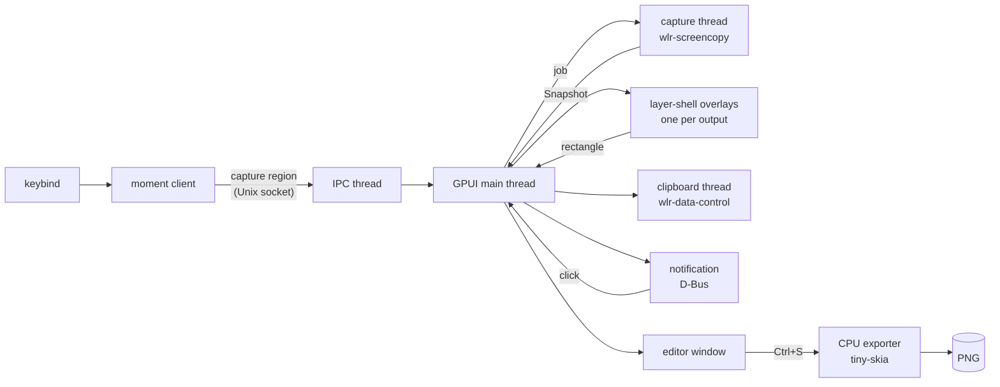

# Architecture

One binary, two roles: a thin **client** (`moment capture …`) that sends one
line over a Unix socket, and a resident **daemon** (`moment daemon`) that does
the work. Keeping the daemon alive is the main latency win: the Wayland
connections, bound globals, shared-memory buffers, GPU device and shader
pipelines all exist before the keybind is pressed.

## Threads

| Thread | Owns | Notes |
| --- | --- | --- |
| GPUI main | windows, shots, documents | All UI state; never blocks. |
| `moment-ipc` | the listening socket | One short-lived thread per connection, so an interactive selection never blocks `open-last` or `ping`. |
| `moment-capture` | its own Wayland connection, outputs, `wl_shm` buffers | Captures every requested output concurrently; buffers are reused while an output's mode is unchanged. Waits are bounded (3 s) so a wedged compositor cannot hang it. |
| `moment-clipboard` | a second Wayland connection, the data-control selection | Claims the selection immediately; a paste blocks only until the background PNG encoder finishes. |
| `moment-notify` | D-Bus signal subscriptions | Maps notification ids to shots; a click opens the editor. |
| GPUI background pool | PNG encoding, tile building, composition, export | |

The capture and clipboard threads use their own connections rather than
GPUI's: GPUI's event loop is not exposed, and data-control needs no focused
surface (the daemon usually has none), unlike `wl_data_device`.

## Capture path

1. `wlr-screencopy` frames for all outputs are requested at once. The
   compositor fills reused memfd buffers.
2. Each buffer becomes a BGRA `Image`: `XRGB8888`/`ARGB8888` are already BGRA
   in memory on little-endian machines, so conversion is a copy that forces
   alpha to 255. `XBGR`, and 10-bit formats are converted. `y_invert` and the
   output transform are undone so the image matches what the user sees
   (verified against `grim` on rotated and scaled outputs in the e2e suite).
3. A `Snapshot` holds every output as `Arc<Image>` plus its logical
   rectangle. `Snapshot::compose(rect)` builds any logical rectangle at the
   highest scale among the outputs it touches; a whole-output request returns
   the same `Arc` without copying.

## Region selection

All outputs are captured *before* the overlays open, so the selection shows a
frozen screen and the final crop comes from that snapshot, not from the
dimmed overlay. Each output gets a full-screen `wlr-layer-shell` surface on
the overlay layer with exclusive keyboard focus, painting the frozen image
from GPU tiles that were built on the background pool while the Hyprland
window list was fetched. All overlays share one `Selection` entity in global
logical coordinates; because Wayland keeps delivering motion to the surface
that received the button press, a drag can cross outputs.

## Shots, documents and the editor

A `Shot` is an immutable capture (`Arc<Image>`, scale, time). Its GPU tiles
(`RenderImage`s of at most 4096² — every GPU supports that size) are built
once on a background thread right after capture, so opening the editor only
uploads textures.

A `Document` holds annotation shapes over a shot plus a crop and an undo
history. Shapes are immutable `Arc<Shape>`s; edits replace them, so undo
snapshots are vectors of pointers and each shape caches its render
primitives for its whole life. Documents live in the daemon keyed by shot,
which is why closing and reopening the editor keeps annotations.

### One geometry, two renderers

`render::shape_prims` turns a shape into primitives in image space:

- every stroke is converted to its **filled outline** with tiny-skia's
  stroker (round caps and joins);
- text is laid out with `ttf-parser` from the chosen face and emitted as
  glyph outlines. `fonts` indexes system fonts with `fontdb` on a background
  thread at daemon start, resolves family/weight/italic to font data (variable
  fonts get their `wght` axis set; missing italics are sheared), and falls
  back to the bundled Inter per glyph;
- pixelation is a precomputed patch of mosaic pixels.

The editor fills those outlines with GPUI paths (non-zero winding, 4× MSAA);
the exporter fills the identical outlines with tiny-skia. Neither renderer's
own stroker or text system is involved, so the saved PNG matches the editor
(the `editor_render` test compares them pixel by pixel). The exporter draws
straight into the BGRA buffer by giving tiny-skia colors with red and blue
swapped, so there is no conversion pass in either direction.

## Persistence

- The latest capture is written uncompressed to
  `$XDG_CACHE_HOME/moment/last.raw` (20-byte header + BGRA) in the
  background; `open-last` after a daemon restart reads it in one `read`
  without decoding. Without it, the newest image in the screenshots folder
  is opened.
- Saves are atomic (`*.png.part` then rename).
- The daemon keeps the last eight shots and their documents in memory.

## IPC

See [ipc.md](ipc.md).
