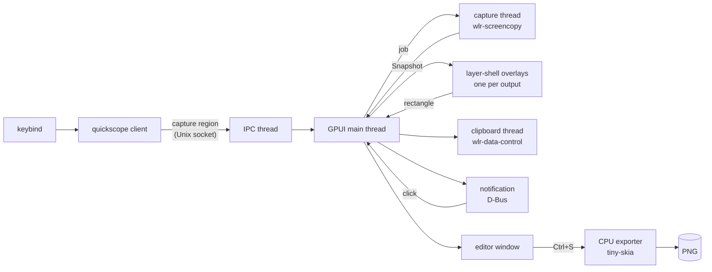

# Architecture

One binary, two roles: a thin **client** (`quickscope capture …`) that sends one
line over a Unix socket, and a resident **daemon** (`quickscope daemon`) that does
the work. Keeping the daemon alive is the main latency win: the Wayland
connections, bound globals, shared-memory buffers, GPU device and shader
pipelines all exist before the keybind is pressed.

## Threads

| Thread | Owns | Notes |
| --- | --- | --- |
| GPUI main | windows, shots, documents | All UI state; never blocks. |
| `quickscope-ipc` | the listening socket | One short-lived thread per connection, so an interactive selection never blocks `open-last` or `ping`. |
| `quickscope-capture` | its own Wayland connection, outputs, `wl_shm` buffers | Captures every requested output concurrently; buffers are reused while an output's mode is unchanged. Waits are bounded (3 s) so a wedged compositor cannot hang it. |
| `quickscope-clipboard` | a second Wayland connection, the data-control selection | Claims the selection immediately; a paste blocks only until the background PNG encoder finishes. |
| `quickscope-notify` | D-Bus signal subscriptions | Maps notification ids to shots; a click opens the editor. |
| `quickscope-ocr-<lang>` | one Tesseract instance (`libtesseract`, opened with `dlopen`) | One thread per language model; the primary stays loaded, others unload after 2 idle minutes. See [text extraction](text-extraction.md). |
| GPUI background pool | PNG encoding, tile building, composition, export | |

The capture and clipboard threads use their own connections rather than
GPUI's: GPUI's event loop is not exposed, and data-control needs no focused
surface (the daemon usually has none), unlike `wl_data_device`.

## Platform backends

Everything that differs between desktops sits behind the traits in
`src/platform/mod.rs`: `Capture` (screen pixels), `Desktop` (focused output,
active window, windows to snap to), `Clipboard`, `Notifier`, and how the
selection overlays become windows (`Surfaces`). `platform::connect` picks the
backends once at daemon start and logs the choice (`platform backend: …`).
Desktop-originated actions (notification clicks, and on platforms without
compositor keybinds, tray menus and global hotkeys) reach the daemon as
`platform::Event`s and run through the same request handler as the IPC
socket.

| Backend | Capture | Clipboard | Overlay | Window knowledge |
| --- | --- | --- | --- | --- |
| `wlroots` | `wlr-screencopy` | `wlr-data-control` | layer-shell | Hyprland IPC when present |
| `x11` | MIT-SHM GetImage, core GetImage fallback | CLIPBOARD selection, PNG/text, INCR | override-redirect PopUp | EWMH |
| `windows` | resident DXGI Desktop Duplication, reusable GDI fallback | delayed PNG + DIBV5/DIB/Unicode | borderless topmost GPUI popup | DWM foreground bounds and filtered top-level Z order |

X11 keeps separate persistent connections for capture, EWMH queries and
clipboard ownership. The capture thread reuses a SysV shared-memory segment;
RandR monitor rectangles use physical root coordinates, with no output scale.
TrueColor pixels become opaque BGRA, and XFixes optionally supplies the cursor.
The selection owner claims CLIPBOARD before the PNG encoder finishes and serves
the same encoded bytes; large transfers advance only when the requestor deletes
the previous INCR property. Popups bypass the window manager, so region selection
sets native keyboard focus after they map and restores the prior focus on exit.
There is no X11 GPU prewarm window because it could flash on the desktop.

GPUI's executable manifest requests per-monitor-v2 DPI awareness; quickscope
verifies it (and sets it if absent) before creating any HWND. Its
snapshot coordinate unit is a physical desktop pixel (scale = 1), preserving
the virtual desktop lattice at mixed DPI, including negative origins.
GPUI 0.3.10 instead divides each monitor's global origin by its own scale;
using those origins for composition would introduce gaps/overlaps. The
Windows monitor placement maps physical bounds to GPUI DIPs; the shared overlay
viewport mapping converts pointer positions and selection highlights between
physical pixels and surface DIPs for both X11 and Windows.
Thus cross-monitor crops and DWM window bounds retain native pixels.

All DXGI COM/GDI resources stay on one capture thread. Duplication, device,
staging texture, DC and DIB allocations survive requests; timeout reuses a
valid last frame, while access loss discards duplication resources for
recreation. Unsupported duplication falls back to GDI. Cursor-free captures
use GDI when DXGI reports an already-embedded pointer; requested cursors are
drawn with their actual hotspot. The hidden shell window owns the tray,
registered hotkeys and delayed clipboard formats. PNG encoding starts once
with `PendingPng`, and WM_RENDERFORMAT serves those same encoded bytes.
The Windows IPC transport is AF_UNIX (Windows 10 1803+), under the current
user's LocalAppData directory and its inherited ACL, retaining the same
one-line protocol, liveness probe and second-daemon refusal.

## Capture path

1. `wlr-screencopy` frames for all outputs are requested at once. The
   compositor fills reused memfd buffers.
2. Each buffer becomes a BGRA `Image`: `XRGB8888`/`ARGB8888` are already BGRA
   in memory on little-endian machines, so conversion is a copy that forces
   alpha to 255. `XBGR`, and 10-bit formats are converted. `y_invert` and the
   output transform are undone so the image matches what the user sees
   (verified against `grim` on rotated and scaled outputs in the e2e suite).
3. A `Snapshot` holds every output as `Arc<Image>` plus its logical
   rectangle. `Snapshot::compose(rect)` builds any logical rectangle at the
   highest scale among the outputs it touches; a whole-output request returns
   the same `Arc` without copying.

## Region selection

All outputs are captured *before* the overlays open, so the selection shows a
frozen screen and the final crop comes from that snapshot, not from the
dimmed overlay. Each output gets a full-screen `wlr-layer-shell` surface on
the overlay layer with exclusive keyboard focus, painting the frozen image
from GPU tiles that were built on the background pool while the Hyprland
window list was fetched. All overlays share one `Selection` entity in global
logical coordinates; because Wayland keeps delivering motion to the surface
that received the button press, a drag can cross outputs.

## Shots, documents and the editor

A `Shot` is an immutable capture (`Arc<Image>`, scale, time). Its GPU tiles
(`RenderImage`s of at most 4096² — every GPU supports that size) are built
once on a background thread right after capture, so opening the editor only
uploads textures.

A `Document` holds annotation shapes over a shot plus a crop and an undo
history. Shapes are immutable `Arc<Shape>`s; edits replace them, so undo
snapshots are vectors of pointers and each shape caches its render
primitives for its whole life. Documents live in the daemon keyed by shot,
which is why closing and reopening the editor keeps annotations.

### One geometry, two renderers

`render::shape_prims` turns a shape into primitives in image space:

- every stroke is converted to its **filled outline** with tiny-skia's
  stroker (round caps and joins);
- text is shaped and emitted as glyph outlines (see below);
- pixelation is a precomputed patch of mosaic pixels;
- colour emoji glyphs are bitmaps (PNG strikes) resampled once to the size
  they are drawn at and placed as images.

Text layout (`text.rs`): each line is split into bidi runs in visual order
(`unicode-bidi`), each run into items that share a face and a script, and
each item is shaped with `rustybuzz` (kerning, ligatures, Arabic joining,
Indic conjuncts; neighbouring text is passed as context so joins survive
face changes). Faces are chosen per grapheme: the chosen font, then the
bundled Inter, then any installed font that has every visible char of the
grapheme. `fonts` indexes system fonts with `fontdb` on a background thread
at daemon start; the fallback search ranks Noto families first, prefers colour
emoji fonts for emoji, and for Han picks the CJK variant (JP, KR, SC, TC,
HK) the text itself implies (kana, hangul) or else the locale's, else
Japanese. Results are cached per grapheme. Variable fonts get their `wght`
(and `opsz`) axes set for both shaping and outlines; missing italics are
sheared.

### Text input and input methods

While the text tool is editing, the editor registers a GPUI
`EntityInputHandler`. That is what makes GPUI's Wayland backend enable
`text-input-v3`, so input methods (fcitx5, IBus) compose into the text:
pre-edit is shown underlined at the caret, the candidate window is anchored
there (`bounds_for_range`), and commits replace the pre-edit. When no text is
being edited the editor registers no handler, so the input method is off and
single-key tool shortcuts reach the editor. The text buffer
(`ui/edit_buffer.rs`) keeps byte offsets, converts the platform's UTF-16
ranges, and moves and deletes by grapheme. The font menu's family search
field is a text input too; number and hex fields refuse text input so an IME
cannot turn digits full-width.

The editor fills those outlines with GPUI paths (non-zero winding, 4× MSAA);
the exporter fills the identical outlines with tiny-skia. Neither renderer's
own stroker or text system is involved, so the saved PNG matches the editor
(the `editor_render` test compares them pixel by pixel). The exporter draws
straight into the BGRA buffer by giving tiny-skia colors with red and blue
swapped, so there is no conversion pass in either direction.

## Persistence

- The latest capture is written uncompressed to
  `$XDG_CACHE_HOME/quickscope/last.raw` (20-byte header + BGRA) in the
  background; `open-last` after a daemon restart reads it in one `read`
  without decoding. Without it, the newest image in the screenshots folder
  is opened.
- Saves are atomic (`*.png.part` then rename).
- The daemon keeps the last eight shots and their documents in memory.

## IPC

See [ipc.md](ipc.md).
