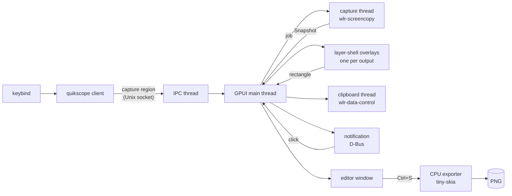

# Architecture

One binary, two roles: a thin **client** (`quikscope capture …`) that sends one
line over a Unix socket, and a resident **daemon** (`quikscope daemon`) that does
the work. Keeping the daemon alive is the main latency win: the Wayland
connections, bound globals, shared-memory buffers, GPU device and shader
pipelines all exist before the keybind is pressed.

The diagram shows the default frozen region path. Live region selection opens
overlays from output geometry first and requests pixels only after selection
and synchronized overlay teardown.

## Threads

| Thread | Owns | Notes |
| --- | --- | --- |
| GPUI main | windows, shots, documents | UI state; short atomic config edits and teardown barriers; capture/encoding stay on workers. |
| `quikscope-ipc` | the listening socket | One short-lived thread per connection, so an interactive selection never blocks `open-last` or `ping`. |
| `quikscope-capture` | its own Wayland connection, outputs, `wl_shm` buffers | Captures every requested output concurrently; buffers are reused while an output's mode is unchanged. Waits are bounded (3 s) so a wedged compositor cannot hang it. |
| `quikscope-clipboard` | a second Wayland connection, the data-control selection | Claims the selection immediately; a paste blocks only until the background PNG encoder finishes. |
| `quikscope-notify` | D-Bus signal subscriptions | Maps notification ids to shots; a click opens the editor. |
| `quikscope-ocr-<lang>` | one Tesseract instance (`libtesseract`, opened with `dlopen`) | One thread per language model; the primary stays loaded, others unload after 2 idle minutes. See [text extraction](text-extraction.md). |
| GPUI background pool | PNG encoding, tile building, composition, export | |

The capture and clipboard threads use their own connections rather than
GPUI's: GPUI's event loop is not exposed, and data-control needs no focused
surface (the daemon usually has none), unlike `wl_data_device`.

## Platform backends

Everything that differs between desktops sits behind the traits in
`src/platform/mod.rs`: `Capture` (screen pixels), `Desktop` (focused output,
active window, windows to snap to), `Clipboard`, `Notifier`, and how the
selection overlays become windows (`Surfaces`). `platform::connect` picks the
backends once at daemon start and logs the choice (`platform backend: …`).
Desktop-originated actions (notification clicks, and on platforms without
compositor keybinds, tray menus and global hotkeys) reach the daemon as
`platform::Event`s and run through the same request handler as the IPC
socket.

| Backend | Capture | Clipboard | Overlay | Window knowledge |
| --- | --- | --- | --- | --- |
| `wlroots` | `wlr-screencopy` | `wlr-data-control` | layer-shell | Hyprland IPC when present |
| `x11` | MIT-SHM GetImage, core GetImage fallback | CLIPBOARD selection, PNG/text, INCR | override-redirect PopUp | EWMH |
| `windows` | resident DXGI Desktop Duplication, reusable GDI fallback | delayed PNG + DIBV5/DIB/Unicode | borderless topmost GPUI popup | DWM foreground bounds and filtered top-level Z order |
| `portal` | Screenshot portal → PNG | data-control, Xwayland CLIPBOARD fallback | layer-shell when offered; otherwise one fullscreen xdg-toplevel | none |
| `macos` | ScreenCaptureKit display streams (12.3+) | promised PNG and TIFF through NSPasteboard | nonactivating GPUI popup panels, level 101 | CoreGraphics on-screen layer-0 front-to-back window list |

X11 keeps separate persistent connections for capture, EWMH queries and
clipboard ownership. The capture thread reuses a SysV shared-memory segment;
RandR monitor rectangles use physical root coordinates, with no output scale.
TrueColor pixels become opaque BGRA, and XFixes optionally supplies the cursor.
The selection owner claims CLIPBOARD before the PNG encoder finishes and serves
the same encoded bytes; large transfers advance only when the requestor deletes
the previous INCR property. Popups bypass the window manager, so region selection
sets native keyboard focus after they map and restores the prior focus on exit.
There is no X11 GPU prewarm window because it could flash on the desktop.

### macOS

The native shell is created inside GPUI's main-thread application callback.
Cocoa status-item/delegate objects stay in thread-local storage; Send/Sync
service handles marshal notifications and cleanup onto the main queue.
Carbon global hotkeys and menu actions feed the same `Event::Request` channel
as IPC, and UserNotifications activation feeds `Event::OpenShot`.
Unbundled invocations disable notifications rather than calling
`UNUserNotificationCenter` without a valid bundle identity.

Capture uses ScreenCaptureKit streams rather than its macOS-14-only
still-image API. Every requested display produces BGRA with `showsCursor`
set from the request. Native dimensions apply the display mode's Retina
factor to its oriented desktop bounds, so a rotated display does not inherit
the unrotated mode's aspect ratio. Logical geometry uses CoreGraphics'
top-left desktop points, preserving Retina scale and negative display origins.
Permission checks request Screen Recording access
and report a Settings remedy instead of returning a wallpaper-only image.
Stream startup/frame waits are bounded and streams stop after the frame.

Selection uses GPUI's `PopUp` panels, whose macOS implementation sets level
101 and `CanJoinAllSpaces | FullScreenAuxiliary`. A numeric display ID selects
the matching NSScreen; GPUI expects display-relative popup origins. Native
panels are ordered out before deferred GPUI destruction and the next live
capture stream starts. Interactive multi-display/Space behavior still needs
native manual verification.

### Screenshot portal

This integration is experimental: automated checks use a simulated portal in
headless labwc, not a real GNOME or KDE desktop.

On Wayland, native screencopy is attempted first; if it is unavailable, use
the Screenshot portal. `QUIKSCOPE_BACKEND=portal|wlroots` forces the choice.
Both the session-bus connection and a separate Wayland output-layout
connection are kept alive. A Request/Response subscription is installed
before `Screenshot("", {interactive: false, handle_token: …})`; filtering
uses the returned request handle, including older non-token-derived handles.
Codes 1/2 report cancellation/denial/failure. Local `file://` URIs are
percent-decoded using `url`, then decoded into BGRA.

The desktop raster is split using wl_output + xdg-output logical bounds;
negative origins, gaps and uniform fractional scaling are supported.
Output changes during the portal dialog produce an error instead of using
stale geometry. The API has no per-output scale metadata: nonuniform
mixed-scale rasters whose aspect ratio differs from the logical desktop
are rejected. The desktop controls pointer inclusion (the Screenshot
interface has no cursor option), permission dialogs and capture flashes.

Overlay protocol selection is independent of capture: use layer-shell when
the compositor advertises `zwlr_layer_shell_v1` (including supported KDE
versions). Each output then gets its own overlay, with cross-output dragging.
Without layer-shell, open just one fullscreen xdg-toplevel.
GPUI 0.3.10 does not forward the requested output to `set_fullscreen`, so
the compositor chooses its placement. `Window::display()` tracks the
actual surface-enter output; the overlay maps input in that output's
coordinates and, in frozen mode, switches to its already-prepared frame.
Selection is confined to that output. This is the GNOME multi-monitor
limitation, not a silent crop of the first output.

Compositor animations and fullscreen focus policy cannot be overridden.
Esc/Enter use the same selection handlers as native capture. No GPU
prewarm window is opened on the fullscreen path, avoiding a visible flash.
`QUIKSCOPE_DEBUG_NO_LAYER_SHELL=1` forces this path for diagnostics/tests.
Screen/geometry capture still covers every output, independent of overlay
placement.

Clipboard prefers Wayland data-control. When it is unavailable but DISPLAY
is set, the existing X11 SelectionOwner serves CLIPBOARD over Xwayland;
GNOME normally bridges this selection to Wayland clients. With neither
protocol, clipboard is unavailable and the reason is logged.

Files are deliberately retained, even under `/tmp`: the portal does not
grant ownership or specify cleanup. [KDE's implementation][kde-screenshot]
saves `Pictures/Screenshot_*.png`; [GNOME's implementation][gnome-screenshot]
asks Shell to create a named screenshot. Document-portal paths are not
necessarily disposable files either.

The faster KWin ScreenShot2 API was considered, not selected: [Plasma 6.5
checks restricted-interface authorization][kwin-screenshot] for the caller
PID. Newer KWin development sources remove that check, but that is not a
portable contract across deployed desktops. No permission bypass or
desktop-specific window-query service is required; `Desktop` returns
"unknown", so there is no active-window capture or snapping.

[portal-screenshot]: https://flatpak.github.io/xdg-desktop-portal/docs/doc-org.freedesktop.portal.Screenshot.html
[kde-screenshot]: https://github.com/KDE/xdg-desktop-portal-kde/blob/master/src/screenshot.cpp
[gnome-screenshot]: https://github.com/GNOME/xdg-desktop-portal-gnome/blob/main/src/screenshotdialog.c
[kwin-screenshot]: https://github.com/KDE/kwin/blob/Plasma/6.5/src/plugins/screenshot/screenshotdbusinterface2.cpp

See the [Screenshot portal specification][portal-screenshot] for its
permission and cursor limitations.

GPUI's executable manifest requests per-monitor-v2 DPI awareness; quikscope
verifies it (and sets it if absent) before creating any HWND. Its
snapshot coordinate unit is a physical desktop pixel (scale = 1), preserving
the virtual desktop lattice at mixed DPI, including negative origins.
GPUI 0.3.10 instead divides each monitor's global origin by its own scale;
using those origins for composition would introduce gaps/overlaps. The
Windows monitor placement maps physical bounds to GPUI DIPs; the shared overlay
viewport mapping converts pointer positions and selection highlights between
physical pixels and surface DIPs for both X11 and Windows.
Thus cross-monitor crops and DWM window bounds retain native pixels.
This coordinate mapping is implemented but has not yet been verified with
multiple monitors or mixed DPI on a native Windows desktop.

All DXGI COM/GDI resources stay on one capture thread. Duplication, device,
staging texture, DC and DIB allocations survive requests; timeout reuses a
valid last frame, while access loss discards duplication resources for
recreation. Unsupported duplication falls back to GDI. Cursor-free captures
use GDI when DXGI reports an already-embedded pointer; requested cursors are
drawn with their actual hotspot. The hidden shell window owns the tray,
registered hotkeys and delayed clipboard formats. PNG encoding starts once
with `PendingPng`, and WM_RENDERFORMAT serves those same encoded bytes.
The Windows IPC transport is AF_UNIX (Windows 10 1803+), under the current
user's LocalAppData directory and its inherited ACL, retaining the same
one-line protocol, liveness probe and second-daemon refusal.

## Capture path

1. `wlr-screencopy` frames for all outputs are requested at once. The
   compositor fills reused memfd buffers.
2. Each buffer becomes a BGRA `Image`: `XRGB8888`/`ARGB8888` are already BGRA
   in memory on little-endian machines, so conversion is a copy that forces
   alpha to 255. `XBGR`, and 10-bit formats are converted. `y_invert` and the
   output transform are undone so the image matches what the user sees
   (verified against `grim` on rotated and scaled outputs in the e2e suite).
3. A `Snapshot` holds every output as `Arc<Image>` plus its logical
   rectangle. `Snapshot::compose(rect)` builds any logical rectangle at the
   highest scale among the outputs it touches; a whole-output request returns
   the same `Arc` without copying.

## Region selection

With `freeze = true` (the default), selection shows a frozen screen, and the
final crop comes from that snapshot, not from the dimmed overlay. Each output
gets a full-screen `wlr-layer-shell` surface on the overlay layer with
exclusive keyboard focus, painting the frozen image from GPU tiles that were
built on the background pool while the window list was fetched. All overlays
share one `Selection` entity in global logical coordinates; because Wayland
keeps delivering motion to the surface that received the button press, a drag
can cross outputs.

Creating a window costs about as much as the capture itself (~12 ms each,
mostly surface and swapchain setup), so on layer-shell the two overlap: the
capture is started first, then one overlay per display opens *transparent*
and ignoring input while the compositor produces the frame. A frame that
happens to include the new surface therefore shows the desktop unchanged.
When the snapshot arrives each overlay receives its output's tiles and
starts dimming; if an output has no early overlay (hotplug during the
capture) they close and the regular path opens fresh ones. X11 and Windows
popups would capture as black without a compositor and fullscreen toplevels
animate in, so those open after the capture as before. Frozen portal captures
never get early overlays, even on layer-shell (KDE): the desktop may show a
permission dialog first, and an overlay's exclusive keyboard would keep the
user from answering it.

With `freeze = false` (CLI `--no-freeze`, IPC `no-freeze`), overlays use output
geometry without taking an initial screenshot. They paint translucent dimming
outside the selected rectangle and leave a transparent hole inside. Selection
gestures and window snapping are shared with frozen mode. Once selection
finishes, all overlays close before capture; the resulting new snapshot is
cropped to the selected rectangle. Cancellation takes no screenshot. Fixed
geometry and noninteractive modes bypass this choice.

Closing a GPUI window alone is not a compositor teardown barrier:

- Wayland records GPUI's raw display before closing and, after GPUI has
  destroyed the surfaces, performs a private-queue roundtrip on that **same**
  borrowed display. The compositor has therefore processed surface destruction
  before the separate capture connection requests screencopy or a portal
  screenshot. Native screencopy supplies the next rendered frame.
- X11 subscribes to overlay `DestroyNotify` before closing, waits for
  destruction, then waits for an X Present vblank barrier before capture.
  Live selection requires a compositor, an alpha visual and Present; without
  them it logs the limitation and falls back to the existing frozen path.
- Windows synchronously hides the overlay HWNDs (GPUI defers native window
  destruction), then uses `DwmFlush` before capture.
  Frozen and live selection were verified natively on one Windows 11 monitor
  at 96 DPI; Windows 10, mixed DPI and multiple monitors remain unverified.

Portal live captures ask permission only after selection and teardown, so the
overlays cannot intercept the permission dialog's keyboard input. Without
layer-shell (normally GNOME), selection remains confined to the output where
the fullscreen window lands; transparency depends on the compositor allowing
transparent fullscreen windows.

The interactive selection claim remains held until the live capture finishes,
including any portal permission dialog. Another selector cannot steal the
keyboard or contaminate that pending capture with new dimming overlays.

## Shots, documents and the editor

A `Shot` is an immutable capture (`Arc<Image>`, scale, time). Its GPU tiles
(`RenderImage`s of at most 4096² — every GPU supports that size) are built
once on a background thread right after capture, so opening the editor only
uploads textures.

A `Document` holds annotation shapes over a shot plus a crop and an undo
history. Shapes are immutable `Arc<Shape>`s; edits replace them, so undo
snapshots are vectors of pointers and each shape caches its render
primitives for its whole life. Documents live in the daemon keyed by shot,
which is why closing and reopening the editor keeps annotations.

The editor keeps selection membership in an ordered set of shape IDs.
Document batch operations checkpoint once per user action; live drag and
color-picker updates reuse that snapshot, so undo never exposes a partially
moved or recolored group. Gesture membership is immutable and shared across
pointer events. Marquee selection uses full shape bounds rather than
intersection, and stacking commands preserve relative order within both
the selection and the remaining shapes.

### One geometry, two renderers

`render::shape_prims` turns a shape into primitives in image space:

- every stroke is converted to its **filled outline** with tiny-skia's
  stroker (round caps and joins);
- text is shaped and emitted as glyph outlines (see below);
- pixelation is a precomputed patch of mosaic pixels;
- colour emoji glyphs are bitmaps (PNG strikes) resampled once to the size
  they are drawn at and placed as images.

Text layout (`text.rs`): each line is split into bidi runs in visual order
(`unicode-bidi`), each run into items that share a face and a script, and
each item is shaped with `rustybuzz` (kerning, ligatures, Arabic joining,
Indic conjuncts; neighbouring text is passed as context so joins survive
face changes). Faces are chosen per grapheme: the chosen font, then the
bundled Inter, then any installed font that has every visible char of the
grapheme. `fonts` indexes system fonts with `fontdb` on a background thread
at daemon start; the fallback search ranks Noto families first, prefers colour
emoji fonts for emoji, and for Han picks the CJK variant (JP, KR, SC, TC,
HK) the text itself implies (kana, hangul) or else the locale's, else
Japanese. Results are cached per grapheme. Variable fonts get their `wght`
(and `opsz`) axes set for both shaping and outlines; missing italics are
sheared.

### Text input and input methods

While the text tool is editing, the editor registers a GPUI
`EntityInputHandler`. That is what makes GPUI's Wayland backend enable
`text-input-v3`, so input methods (fcitx5, IBus) compose into the text:
pre-edit is shown underlined at the caret, the candidate window is anchored
there (`bounds_for_range`), and commits replace the pre-edit. When no text is
being edited the editor registers no handler, so the input method is off and
single-key tool shortcuts reach the editor. The text buffer
(`ui/edit_buffer.rs`) keeps byte offsets, converts the platform's UTF-16
ranges, and moves and deletes by grapheme. The font menu's family search
field is a text input too; number and hex fields refuse text input so an IME
cannot turn digits full-width.

The editor fills those outlines with GPUI paths (non-zero winding, 4× MSAA);
the exporter fills the identical outlines with tiny-skia. Neither renderer's
own stroker or text system is involved, so the saved PNG matches the editor
(the `editor_render` test compares them pixel by pixel). The exporter draws
straight into the BGRA buffer by giving tiny-skia colors with red and blue
swapped, so there is no conversion pass in either direction.

## Persistence

- The latest capture is written uncompressed to
  `$XDG_CACHE_HOME/quikscope/last.raw` (20-byte header + BGRA) in the
  background; `open-last` after a daemon restart reads it in one `read`
  without decoding. Without it, the newest image in the screenshots folder
  is opened.
- Saves are atomic (`*.png.part` then rename).
- The daemon keeps the last eight shots and their documents in memory.

## Settings and onboarding

The daemon keeps one settings-window handle; command-line IPC, the editor's
`OpenSettings` action and Windows tray request all open or focus that handle.
The view uses the editor theme and reusable single-line fields. Typed values
are written through `config::persist_values`, which parses the original,
edits the relevant TOML paths with `toml_edit`, validates the entire result,
and atomically replaces the file while retaining comments and decorations.
Invalid original files or edits remain untouched and display an inline error.
Config writes from UI and notification IPC run on the app thread to serialize
their read/edit/replace transactions.

After a successful edit, the daemon swaps its `Arc<Config>` and the
`EditorServices` config together, updating capture notification state and
Windows hotkey registrations. Existing editor styles are not rewritten.
An open settings view refreshes after the originating entity update ends,
so IPC/tray changes cannot leave stale toggle state or re-enter a borrowed
view. Dirty field text is retained; Escape discards it back to the saved value.
Missing config files trigger a short welcome form; its choices preview in
memory, and Done or native close commits them. Creating the validated config
file is the onboarding marker, not a second flag or state file.

## IPC

See [ipc.md](ipc.md).
